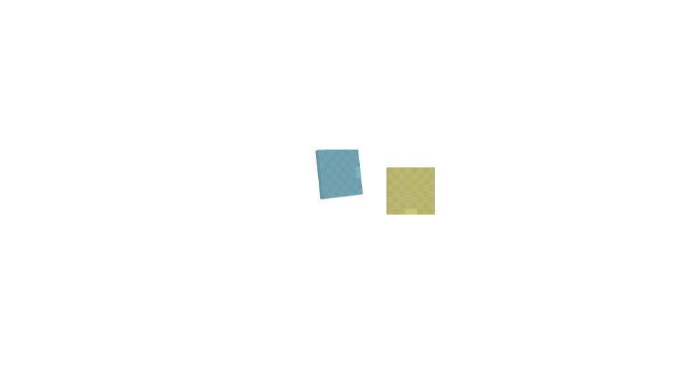

# 左手の食事モーション（0.2.24候補）

0.2.23の保持・使用・HUDを維持し、食事中の左手アイテムにだけ移動と回転を加えます。[提供パックの調査](eating-animation-research.md)を参考にした反対側の動きです。食べかけ画像への切り替え、食品の別名定義、追加テクスチャはありません。

## 動きと同期

- 最初の0.25秒で、左手用itemボーンを中央へ寄せます。位置のXは最大+12、Yは最大+3モデル単位。
- 回転Xは最大32度、Zは最大−96度。参考の右手向けの式からX移動とZ回転の符号を反転しています。
- 0.25秒後は位置Zを振幅2、毎秒4回で揺らします。
- playerのfirst_personかつpaperdollではない描画だけが対象です。右手用ボーン・腕・第三人称・インベントリ内の人物には変形を加えません。
- 対象はJavaが左手のCONSUMABLE使用を通知した時です。食品・飲み物に同じ動きを使います。開始通知を待つため、入力が拒否された場合に動きだけ先行しません。

Geyserのentity property APIでplayerへ `nativeoffhand:eating`（0/1）を登録し、開始時に本人のruntime entity IDへAnimateEntityPacketを1回送ります。animationは `animation.nativeoffhand.eating.left`、controllerは `nativeoffhand_eating`。停止条件はこのpropertyが0になること、blend-outは0.1秒です。

Javaの使用終了・中断通知、または左手アイテムの種類が変わるとpropertyを0へ戻します。使用中の連続入力はアニメーションもJavaの食事も再開始しません。1個を食べ終わった後、入力を保持して次の1個の食事が始まる場合は、新しい動きが始まります。

Javaの左手使用フラグはGeyserへ渡す前にコピーしたメタデータで抑制します。元パケットとほかのメタデータは変更せず、右手に一瞬USING_ITEM=trueを送る経路を避けます。プレイヤーのentity定義や既存animation controllerを上書きせず、専用のanimationファイルだけを追加します。integrated packの有効化が必要です。

## インベントリを開く時の表示準備

従来の順序はContainerOpen → UI用アイテム定義の送信でした。0.2.24では、通常プレイヤーインベントリのopen処理に限り、UI用定義を先に送ってからContainerOpenを送ります。最初のインベントリフレームで、まだ元の定義を保持している時間を減らす修正候補です。

Geyserの既定PlayerInventoryTranslatorを使用するsessionのholderだけに適用します。別の拡張が独自translatorを使っている場合は置き換えません。非同期のlatency callbackによるopenでも、実際のopen直前に同じ処理を行います。プレイヤーが切断した時と拡張終了時には、追加したtranslatorを解除します。

保持定義を常時カスタム化する方式ではありません。閉じる際のブロック描画のキャッシュ更新（空表示と新しいprotocol stack IDによる復元）は、0.2.23で確認された処理を維持しています。この修正で開閉すべてのフレームのちらつきがなくなったことは、実機確認前なので保証しません。

## 確認結果

[統合試験78項目](../tests/results/2026-10-12-left-eating.json)が通過しました。食品・ポーションの開始と完了、同じ食事中の連続入力、左手の種類変更による停止、23種類の出し入れ、ブロック設置、属性保持、HUDを確認しています。往復試験ではContainerOpenを受信した瞬間のスナップショットにUI定義がすでに含まれることも検査します。

[Blockbench 5.2.2の21点の評価値](research/left-eating-blockbench.json)では、第一人称の値と、第三人称・paperdollで変形が0になることを確認しました。以下は左右のitemマーカーを使った**概略モデル**です。実機の食品形状・保持位置・カメラの再現ではありません。左マーカーは中央へ移動し、右マーカーの位置は不変です。[投影値](previews/left-eating/projection.json)に記録しています。

| 開始 | 0.125秒 | 0.25秒 | 揺れ中 |
| --- | --- | --- | --- |
|  |  |  |  |

[配布パックの構造確認](research/left-eating-build.json)ではPNGが枠画像1枚だけ、player.entityの上書きがなく、モーションの対象がleftitemのみであることを確認しました。パックは約53KBです。

Bedrock実機の左手が中央へ寄る見え方、食事終了後の保持姿勢、通常画面からインベントリ背景へ移る際のちらつきは未確認です。検証サーバーはテスト終了後に保存して停止しました。

## 実機で確認する点

RP 0.2.24で、右手に剣、左手にりんごまたはパンを持ち、空腹時に食事入力を保持します。左から中央へ寄り、食事後に元へ戻ること、右手が動かないことを確認します。途中で持ち替えた場合の復帰も確認します。

斧・食品・石を左手に持ってインベントリを開閉し、アイテムが一瞬消える症状が減るか、元の向き・位置と移動操作が保たれるかを確認します。人物プレビューと背景の左手は別に見ます。
