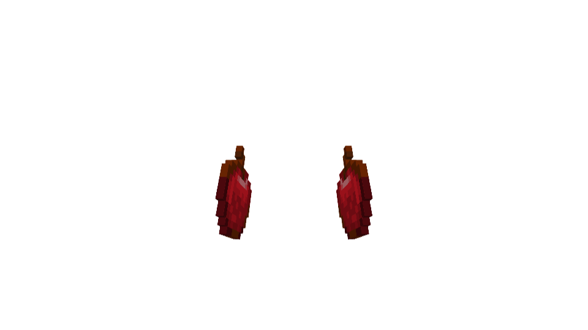
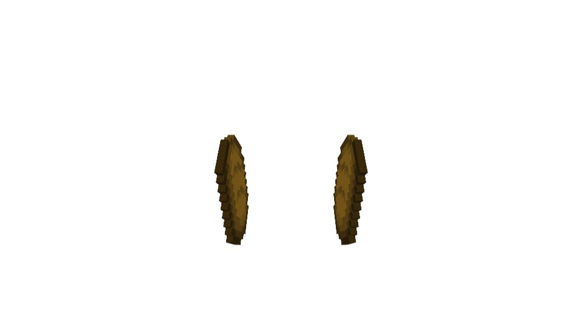
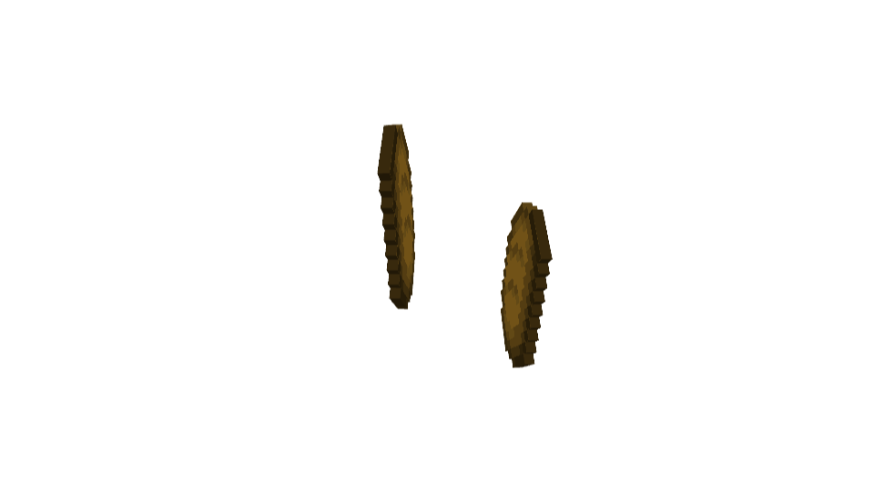

# RP 0.1.13 の Bedrock プレビュー

Web Blockbench 5.2.2 の Bedrock 形式で、パックの実際の食品ジオメトリ、保持・食事アニメーション、Mojang のプレイヤーボーンのピボットを読み込みました。食品の binding は対応する右・左 item ボーンの親子関係として解決しています。Bedrock 本体の attachment 処理、組み込みブロック・道具の描画は実行していません。比較用カメラの位置を使い、実機の画面位置を認証する画像ではありません。

## 左右の食品

右手で使用していた texture mesh と大きさを左手にも使い、右手の保持姿勢を X 軸で鏡映しました。りんご・パンとも、待機時の左モデルのワールド行列が右モデルの X 鏡映と一致しました。比較誤差は 0 です。

食事は待機位置から内側・上へ移動し、上下に反復します。右手の食品の姿勢は維持します。

[Blockbench の画面](bread-blockbench.png) / [確認結果とソース SHA-256](verification.json)

## 座標とアニメーション

Blockbench の `invertMolang` は、今回の三項条件式のチャンネルを直接インポートした場合、意図した軸反転と異なる式を生成しました。そこで元の Molang を一人称・非 VR・表示モードを指定して評価し、得られた数値を Bedrock animation codec へ読み込みました。数値の X 平行移動、X/Y 回転を Blockbench の座標へ変換する処理は標準 codec に任せています。

公式の既定ピボットを使い、`variable.player_arm_height=1`、`context.player_offhand_arm_height=0` として通常の右手と未対応アイテムの左手を比較しました。対象の表示モード 1〜3 では、左手の swap-item 高さ補正が、offhand height の 0・1 どちらでも 0 になります。表示モード 0 はバニラ式を保ちます。

道具の腕姿勢は、数値で評価してから読み込んでも、通常姿勢と握り位置の差が最大約 `2.64e-10` モデル単位でした。組み込みの `hand_equipped` モデルは Blockbench から取得できないため、実機の剣・斧の最終的な向きは別途確認が必要です。ブロックは元の Bedrock ID・block runtime state を使い、独自のブロックモデルを作っていません。

## 再確認

[りんごのテクスチャなしプロジェクト](apple-paired-texture-free.bbmodel) / [パンのテクスチャなしプロジェクト](bread-paired-texture-free.bbmodel)

Web Blockbench でプロジェクトを開き、所有する Minecraft の対応する 16×16 テクスチャを追加すると、数値で解決したボーンと食品の texture mesh を確認できます。保持アニメーションと player の empty-hand / swap-item アニメーションを同時に有効にしてください。食事アニメーションを加えた状態のサンプル値は結果 JSON に記録しています。Minecraft の生の画像ファイルは含めていません。

## 実機

0.1.13 を独立した検証サーバーへ適用しました。実機の提出画像では、食品のモデル位置は変わりましたが、石は引き続き左上に離れて表示されました。ブロックの修正は未完了です。Blockbench の一致と 49 項目のパケットテスト通過を、実機の描画修正が完了したという主張には使いません。
